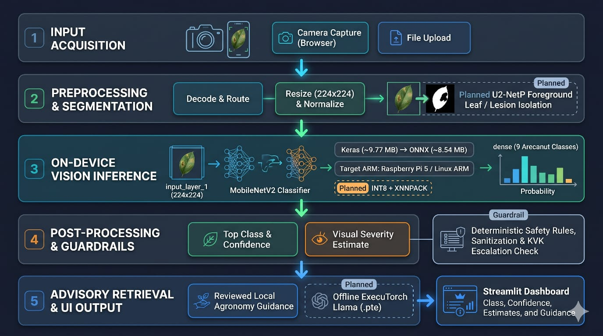

# AdikeRakshak AI - Offline ARM Pipeline

**Arecanut Leaf and Lesion Isolation, On-Device Disease Classification, and Guarded Farmer Advisory**

- **Team:** Beauty Sahani, Daneshwari Hiremath, Aman Singh
- **Target Hardware:** Raspberry Pi 5 / Linux-based ARM device (Offline-First Goal)
- **Date & Status:** 25/11/2026

## ML Architecture

1. **Input Acquisition:** Camera capture (browser + permission) or file upload through Streamlit.
2. **Preprocessing & Segmentation:** Decode & route, resize (`224x224`) & normalize, with planned U2-NetP foreground leaf / lesion isolation.
3. **On-Device Vision Inference:** `input_layer_1` (`224x224`) into MobileNetV2 classifier (Keras ~9.77 MB -> ONNX ~8.54 MB; target ARM: Raspberry Pi 5 / Linux ARM; planned INT8 + XNNPACK) producing `dense` scores across 9 arecanut classes.
4. **Post-Processing & Guardrails:** Top class & confidence, visual severity estimate, and deterministic safety rules, sanitization & KVK escalation check.
5. **Advisory Retrieval & UI Output:** Reviewed local agronomy guidance (planned offline ExecuTorch Llama `.pte`) displayed on the Streamlit dashboard.

## Project Report

- **Report PDF:** [`AdikeRakshak_Offline_ARM_Pipeline_Project_Report_2.pdf`](./AdikeRakshak_Offline_ARM_Pipeline_Project_Report_2.pdf)
